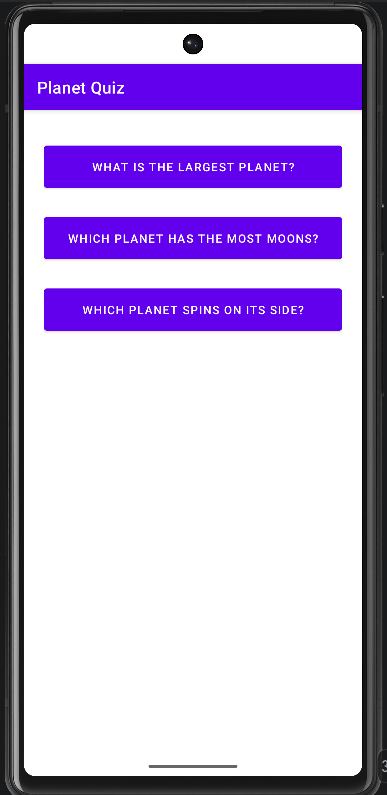
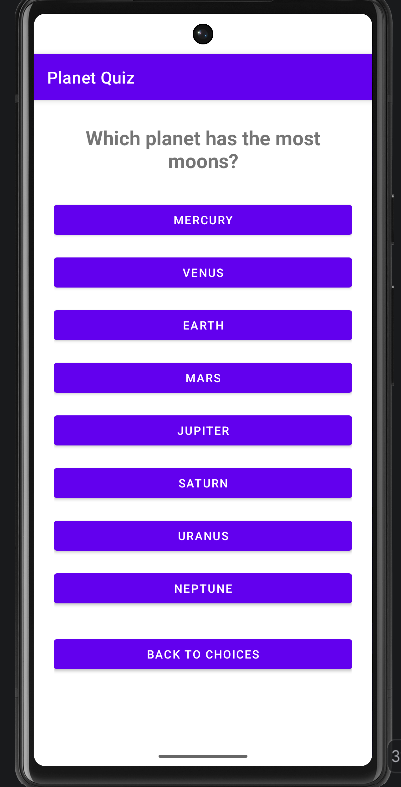
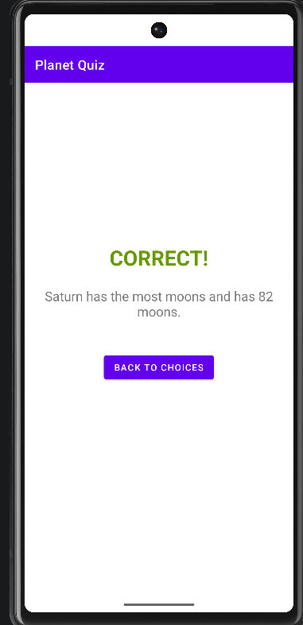
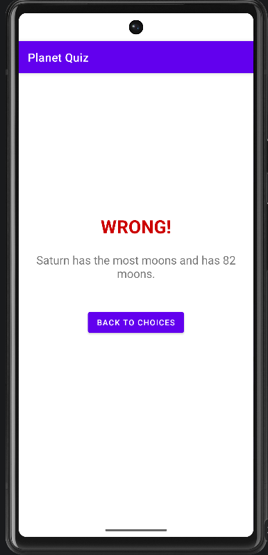

# Solar System Quiz (Rosell_LabActivity_21)

An Android quiz application designed to test your knowledge about the planets in our solar system.

## Features
- **Three Quiz Categories**: Test your knowledge on the largest planet, the planet with the most moons, and the planet that spins on its side.
- **Multiple Choice**: Select your answer from a list of all 8 planets.
- **Immediate Feedback**: Get instant results (Correct/Wrong) along with an explanation for the correct answer.

## App Navigation Flow
1. **Questions Screen**: Choose a trivia question.
2. **Multiple Choice Screen**: Select a planet as your answer.
3. **Answers Screen**: View your result and the explanation. Navigate back to the home screen to try another question.

## Technologies Used
- Kotlin
- Android Architecture Components (Navigation Component)
- View Binding
- Fragments

## Output / Screenshots

| Questions Screen | Multiple Choice Screen | Answers Screen | Wrong Answer
| :---: | :---: | :---: | :---: |
|  |  |  |  

